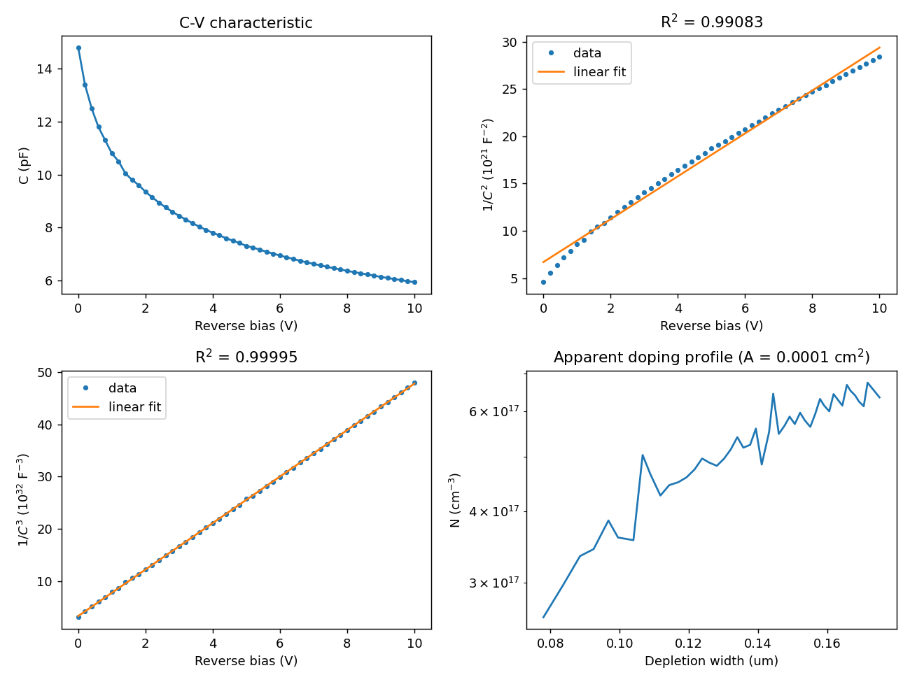
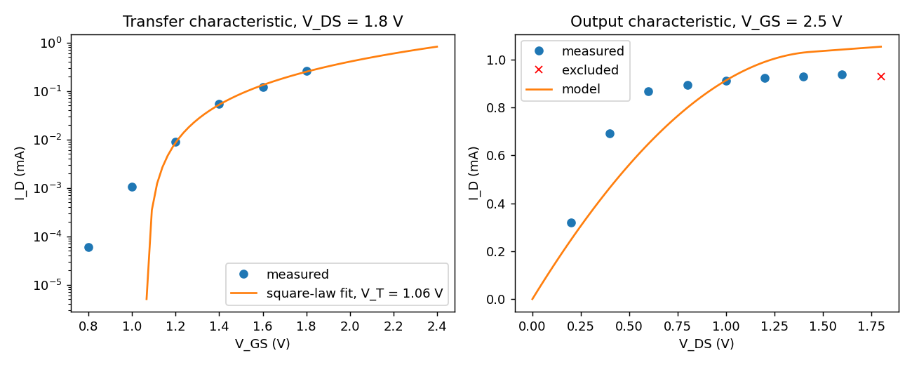

# semiconductor-device-lab

Python tools for analysing six semiconductor-device laboratory experiments carried out at the Physics Teaching Experimental Center, Yangzhou University (Laboratory of Microelectronics Science and Engineering). Each experiment has a step-by-step console walkthrough, a documented analysis routine, reference data, and unit tests. The values in the original lab reports were rechecked and recomputed; the differences are listed in [`docs/CORRECTIONS.md`](docs/CORRECTIONS.md).

## Experiments

| Command | Experiment | Result from the reference data |
|---|---|---|
| `cv` | Varactor C-V characteristic (1S2638) | 1/C³ is linear in V (R² = 0.99995): linearly graded junction, γ ≈ 0.32, V_bi ≈ 0.75 V |
| `four-probe` | Four-probe resistivity | ρ₃₀₀ = 11.12 Ω·cm, n ≈ 4.05×10¹⁴ cm⁻³ (n-type Si) |
| `probe-station` | Manual probe station (ST-103A) | Procedure with an ordering check |
| `bjt` | Curve tracer, DC current gain | h_fe = 120 ± 5; h_FE = 160 and 130 |
| `opamp` | Op-amp V_IO, I_IB, I_IO | 0.330 mV, 3.746 nA, 0.699 nA |
| `mosfet` | CD4069UB MOSFET | V_T = 1.06 V, K = 459 µA/V², r_o ≈ 19 kΩ |





## Installation

Python 3.10 or newer is required.

```bash
git clone https://github.com/abdess-el/semiconductor-device-lab.git
cd semiconductor-device-lab
pip install -e ".[dev]"
```

The editable install (`-e`) is required because the reference data in `data/` is read from the repository.
Without installing the package, use `pip install -r requirements.txt` and run `python -m semilab ...` from the repository root.

## Usage

```bash
semilab list                 # available experiments
semilab run cv               # interactive walkthrough
semilab run all --auto       # run everything on the reference data, no prompts
semilab verify               # values in the original reports vs. recomputed values
pytest -q                    # unit tests
```

In interactive mode Enter advances through the procedure steps. At each input prompt, Enter keeps the value shown in brackets, which is the reference measurement. To analyse your own measurements, type values at the prompts or edit the files in `data/`.

Example (`semilab run mosfet --auto`):

```
Transfer (V_DS=1.8 V): V_T = 1.06 V, K = 459 uA/V^2, R^2 = 0.9962, g_m(1.8V) = 0.68 mA/V
Output (V_GS=2.5 V)  : g_ds = 54 uS, r_o = 19 kOhm, lambda = 0.063 1/V
```

Figures are written to `results/`.

## Data files

| File | Content |
|---|---|
| `data/cv_varactor.csv` | `v_V`, `c_pF`: capacitance at each reverse bias |
| `data/four_probe.json` | resistivity readings, temperature, temperature coefficient, carrier type |
| `data/bjt_curve_tracer.json` | I_C screen divisions and scale, base-current steps, reading uncertainty |
| `data/opamp.json` | resistor values and output voltages for the V_IO, I_IB and I_IO measurements |
| `data/mosfet_transfer.csv`, `data/mosfet_output.csv` | `vgs_V` or `vds_V`, `id_mA`, `valid` (0 marks a point excluded from the fits) |

## Methods

Formulas for each experiment are collected in [`docs/EXPERIMENTS.md`](docs/EXPERIMENTS.md).

## Assumptions

* The junction area of the varactor is not part of the source data. A placeholder of 1×10⁻⁴ cm² is used. Shape results (γ, V_bi, junction type) do not depend on it; absolute doping and grade values scale with it. Enter the datasheet value at the prompt.
* The source gives C_T as "0.84", read as 0.84 %/K = 0.0084 K⁻¹. The literal value 0.84 K⁻¹ gives a negative resistivity.
* The MOSFET table row labelled 2.5 V is read as the output curve at V_GS = 2.5 V (current in mA).
* The carrier type in the four-probe experiment is not stated in the source; n-type is assumed (p-type gives 1.22×10¹⁵ cm⁻³).

## Project layout

```
semilab/      one module per experiment, plus cli.py, plots.py, corrections.py
data/         reference measurements
tests/        unit tests
docs/         experiment formulas and the corrections log
results/      generated figures
```

## License

MIT, see [LICENSE](LICENSE).
